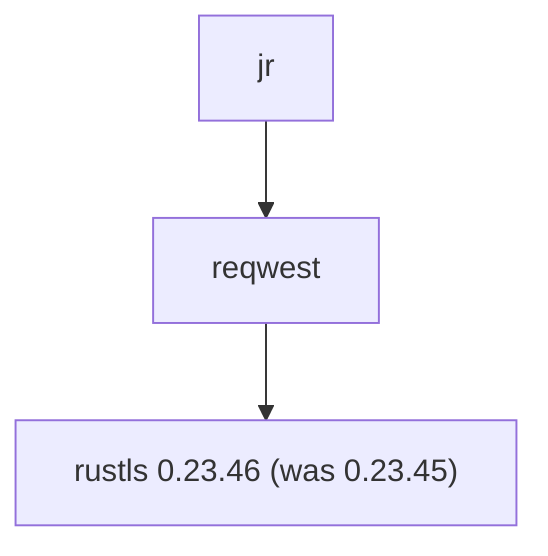
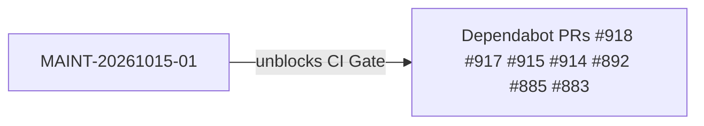
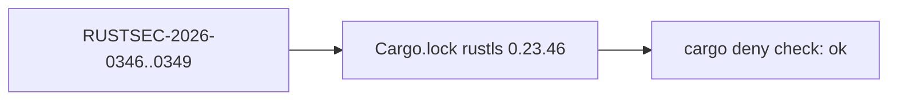

## Finding

MAINT-20261015-01 (maintenance sweep 2026-10-15): `cargo deny check advisories` fails on `develop` because `rustls 0.23.45` is affected by four RustSec advisories. This makes the required `CI Gate` check fail for every PR.

## Severity

LOW for `jr` / not exposed (security-reviewer triage). `jr` is a client-only rustls user via reqwest (features `aws_lc_rs`/`std`/`tls12`), with no ECH, no brotli feature, and no custom `ClientSessionStore`.

| Advisory | Description | jr exposure |
|---|---|---|
| RUSTSEC-2026-0346 | `Debug` impls expose TLS secrets | Not exposed (no Debug logging of rustls session state) |
| RUSTSEC-2026-0347 | Data sent to outer server after ECH rejection | Not exposed (no ECH) |
| RUSTSEC-2026-0348 | Brotli certificate decompression allocates up to 1 GiB | Not exposed (no brotli feature) |
| RUSTSEC-2026-0349 | ServerHello downgrade to classical key exchange | Technically reachable, negligible |

## What Changed

Lockfile-only: `Cargo.lock` `rustls` `0.23.45` -> `0.23.46` (version + checksum, 2 lines). No source, `Cargo.toml`, or behavior changes.

## Why

- Clears all four advisories.
- Unblocks `CI Gate` for the open Dependabot PRs (#918, #917, #915, #914, #892, #885, #883), which currently fail on `cargo deny check advisories` regardless of their own content.
- Note: `v0.7.0` on `main` also ships `rustls 0.23.45`; whether to cut a release is a pending human decision, not part of this PR.

## Testing

Local gates all pass: `cargo fmt --all -- --check`, `cargo clippy --all-targets -- -D warnings`, `cargo test` (5680 passed), `cargo deny check` (all sections ok), MSRV 1.88 `cargo check --all-targets`.

No demo evidence: transparent dependency bump, no user-visible behavior change.

Triage: `.factory/maintenance/rustls-advisory-triage-2026-10-15.md`

## Architecture Changes

None. Lockfile-only dependency patch bump (`rustls` 0.23.45 -> 0.23.46); no module or interface changes.

## Story Dependencies

N/A: maintenance fix, no story dependencies. Does not depend on any open PR.

## Spec Traceability

N/A: no behavioral contracts affected; no behavior change. Driven by `cargo deny check advisories` (RUSTSEC-2026-0346..0349).

## Test Evidence

- `cargo fmt --all -- --check`: pass
- `cargo clippy --all-targets -- -D warnings`: pass
- `cargo test`: 5680 passed
- `cargo deny check`: all sections ok
- MSRV 1.88 `cargo check --all-targets`: pass

## Demo Evidence

N/A: transparent dependency bump with no user-visible behavior change.

## Pre-Merge Checklist

- [x] Local gates pass (fmt, clippy, test, deny, MSRV)
- [ ] Security review complete
- [ ] PR review converged
- [ ] CI Gate green
- [ ] Merge: human code owner action (not performed by the delivery agent)
